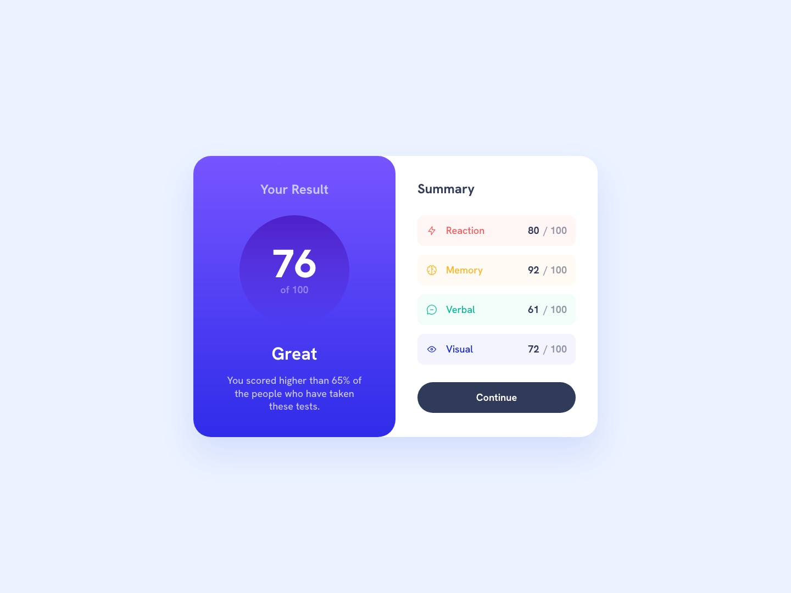

# Frontend Mentor - Results summary component solution

This is a solution to the [Results summary component challenge on Frontend Mentor](https://www.frontendmentor.io/challenges/results-summary-component-CE_K6s0maV). Frontend Mentor challenges help you improve your coding skills by building realistic projects.

## Table of contents

- [Overview](#overview)
  - [Screenshot](#screenshot)
  - [Links](#links)
- [My process](#my-process)
  - [Built with](#built-with)
  - [What I learned](#what-i-learned)
  - [Continued development](#continued-development)
  - [Useful resources](#useful-resources)
  - [AI Collaboration](#ai-collaboration)
- [Author](#author)

## Overview

### Screenshot



### Links

- Solution URL: [Add Frontend Mentor solution URL here](https://www.frontendmentor.io/solutions/TODO)
- Repository: [github.com/temivan/results-summary-card](https://github.com/temivan/results-summary-card)
- Live Site URL: [temivan.github.io/results-summary-card](https://temivan.github.io/results-summary-card/)

## My process

### Built with

- Semantic HTML5 markup (`main` › `article` with a visually hidden `h1`, the summary as a `ul` of category rows, a real `button` for Continue)
- Mobile-first layout: the card stacks on mobile and splits into two side-by-side panels from the `md` breakpoint
- [Vite](https://vite.dev/) + [React](https://react.dev/) + TypeScript
- [Tailwind CSS v4](https://tailwindcss.com/) with an `@theme` that mirrors the Figma variables (colours, gradients, text presets, spacing, card shadow)
- [Oxlint](https://oxc.rs/docs/guide/usage/linter) and [Oxfmt](https://oxc.rs/docs/guide/usage/formatter) with Tailwind class sorting
- GitHub Actions → GitHub Pages (lint, format check and build gate every deploy)

### What I learned

**Let the data drive the card.** The bonus asks for the local JSON to populate the content. The category rows are rendered from `data.json`, and the Total score and Grade are derived from it by one pure function, so changing a score updates the whole card:

```ts
export function summarise(result: Result): ResultSummary {
  const sum = result.reduce((total, { score }) => total + score, 0)
  const totalScore = result.length === 0 ? 0 : Math.round(sum / result.length)
  return { totalScore, grade: gradeFor(totalScore) }
}
```

**Not everything should be computed.** "You scored higher than 65% of the people…" stays fixed copy. The data holds one person's results and nothing about anyone else, so any percentile I computed would be made up. The domain terms are written down in [GLOSSARY.md](./GLOSSARY.md).

**When the data and the design disagree, follow the data.** The design shows Visual as 73, but `data.json` says 72. The card renders 72; the Total score rounds to 76 either way.

**Small details that matter:**

- The page background is the style guide's "pale blue" (`#ecf2ff`, as in the preview JPGs) rather than the Figma desktop frame's slightly different blue. On mobile the page is white, as in the Figma mobile frame.
- The icon paths in the JSON are relative, so they are resolved against `import.meta.env.BASE_URL` to work under the `/results-summary-card/` base path on GitHub Pages.
- Gradients are custom `@utility` classes so their names match the Figma variables.

### Continued development

- There are no automated tests in this project. That was a deliberate call for a small static card, checked by hand and with screenshots instead. The pure `summarise` function would be the first thing to cover if the project grew.
- Visual regression testing (e.g. Playwright screenshots) to catch layout drift between breakpoints.

### Useful resources

- [Tailwind CSS v4 – Theme variables](https://tailwindcss.com/docs/theme) - How `@theme` namespaces map to utilities, including font-size line-height sub-tokens.
- [Tailwind CSS v4 – Adding custom utilities](https://tailwindcss.com/docs/adding-custom-styles#adding-custom-utilities) - For the gradient and text-preset utilities.
- [Vite – Public base path](https://vite.dev/guide/build#public-base-path) - Why runtime asset URLs need `BASE_URL` on GitHub Pages.

### AI Collaboration

I used Claude Code as the implementer while I acted as reviewer:

- **Planning:** an interview-style session to settle the decisions (data-driven rows, a fixed percentile, following the data's 72 over the design's 73, no test tooling), then a written spec and dependency-ordered GitHub issues.
- **Design data:** the Figma MCP server supplied exact measurements, variables and the card shadow instead of eyeballing the JPGs.
- **Implementation:** one ticket at a time, each on its own branch.
- **What worked well:** pulling tokens from Figma kept names and values consistent between design and code.
- **What didn't:** some Figma frames (the tablet frame, whole pages) were too large for the MCP transport, so parts had to be read from metadata, and headless browser screenshots below ~500px wide needed an iframe workaround.

## Author

- GitHub - [@temivan](https://github.com/temivan)
